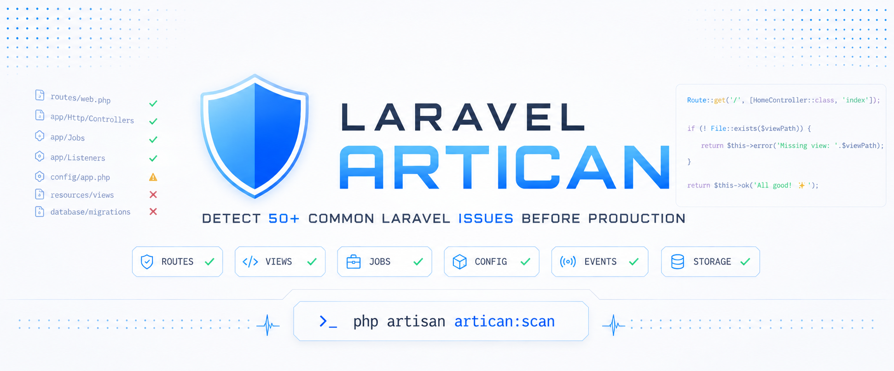

<p align="center">
    
</p>

# Laravel Artican

Artican reads your Laravel code and tells you what is broken before you deploy. It finds things like routes that point to missing controllers, views that don't exist, and database columns your models expect but the table doesn't have.

You run one command. It checks over 50 common problems and shows them grouped by topic, each marked as an error, a warning, or info.

---

## Install

```bash
composer require sajjadhossainshohag/laravel-artican --dev
```

You need PHP 8.1 or newer and Laravel 10, 11, 12 or 13.

If you want to change the settings, publish the config file:

```bash
php artisan vendor:publish --tag=artican-config
```

## Run a scan

```bash
php artisan artican:scan
```

### Options

| Option | What it does |
|---|---|
| `--only=routes,views,env` | Only check the topics you list |
| `--json` | Print the results as JSON |
| `--html` | Print the results as HTML |
| `--fail-on=error,warning` | Exit with code 1 if any issue of these levels is found (useful in CI) |
| `--no-cache` | Ignore saved results and scan again |
| `--parallel` | Split the work across several processes to go faster |
| `--workers=N` | How many processes to use with `--parallel` (picked from your CPU count by default) |
| `--format=agent` | Short JSON output made for AI tools. It turns on by itself inside tools like Claude Code or OpenCode if `laravel/agent-detector` is installed |
| `--help` | Show help |

### Examples

```bash
# Check everything
php artisan artican:scan

# Check only routes and views
php artisan artican:scan --only=routes,views

# Make your CI job fail on any error or warning
php artisan artican:scan --fail-on=error,warning

# Get JSON for other tools to read
php artisan artican:scan --json

# Force a fresh scan
php artisan artican:scan --no-cache

# Scan faster using several processes
php artisan artican:scan --parallel
php artisan artican:scan --parallel --workers=8

# Output for AI agents
php artisan artican:scan --format=agent
```

### Caching

Results are saved for one hour (3600 seconds) so repeat scans are quick. To delete the saved results:

```bash
php artisan artican:cache:clear
```

---

## What Artican checks

### Routes
- **MissingControllerCheck**: a route uses a controller class that doesn't exist.
- **MissingControllerMethodCheck**: a route calls a method the controller doesn't have.
- **DuplicateRouteNamesCheck**: two routes have the same name.
- **DuplicateUrisCheck**: two routes have the same URL and HTTP method.
- **InvalidMiddlewareCheck**: a route uses middleware that isn't registered.
- **RouteClosureBreaksCacheCheck**: a route uses a closure, which stops `php artisan route:cache` from working.

### Views
- **MissingIncludeCheck**: `@include('view')` points to a view that doesn't exist.
- **MissingExtendsCheck**: `@extends('layout')` points to a layout that doesn't exist.
- **MissingComponentCheck**: `@component('name')` points to a component that doesn't exist.
- **StackPushMismatchCheck**: `@push('name')` is used but nothing has a matching `@stack('name')`.

### Blade
- **MissingNamedRoutesCheck**: a template calls `route('name')` for a route that isn't defined, or uses `url('name')` when `route()` was meant.

### Components
- **ComponentClassCheck**: a Blade component alias points to a class that doesn't exist.
- **ComponentNamespaceCheck**: a view namespace points to a folder that doesn't exist.
- **AnonymousComponentCheck**: an anonymous component namespace points to a folder that doesn't exist.

### Eloquent / Models
- **WithCountOnUndefinedRelationshipCheck**: `->withCount('rel')` uses a relationship the model doesn't define.
- **ValueVsFirstOnNullCheck**: `->first()->property` with no null check, which crashes if nothing is found.
- **MissingGuardedOrFillableCheck**: a model has neither `$fillable` nor `$guarded`, so mass assignment is unprotected.
- **AccessorMutatorStyleConflictCheck**: a model mixes the old accessor style with the newer `Attribute::make()` style.
- **GetThenCountCheck**: `->get()` or `->all()` followed by `->count()`, instead of one `->count()` query.

### Schema / Database
- **ColumnMismatchCheck**: columns in `$fillable` or `$casts` don't exist in the real table.
- **InvalidCastsCheck**: a model's `$casts` uses a cast type or class that isn't valid.

### Cache
- **SessionDriverMismatchCheck**: the session driver is `database` but the sessions table doesn't exist.

### Config
- **EarlyConfigAccessCheck**: `config()` is called inside a service provider's `register()` method.
- **AbortIfWrongHttpCodeCheck**: `abort_if()` or `abort_unless()` is given a status code below 400.
- **NonExistentConfigFileCheck**: `config('file.key')` uses a config file that doesn't exist.
- **NonExistentConfigKeyCheck**: `config('file.key')` uses a key that doesn't exist.

### Security
- **RequestAllInCreateCheck**: `request()->all()` is passed straight into `create()` or `update()`, which skips `$fillable` protection.

### Debug
- **DebugStatementLeftInCheck**: `dd()`, `dump()`, `var_dump()`, `ray()` and similar calls are left in PHP or Blade files.

### Jobs / Queue
- **MissingJobClassCheck**: `Job::dispatch()` uses a class that doesn't exist.
- **BusChainCheck**: `Bus::chain()` includes a job class that doesn't exist.
- **JobHasHandleMethodCheck**: a `ShouldQueue` class has no `handle()` method.
- **JobDependencyResolutionCheck**: a job's constructor asks for a type that Laravel can't build.
- **JobTriesZeroCheck**: a job sets `public $tries = 0`, so it never retries.
- **FailedJobTableMissingCheck**: the `failed_jobs` table doesn't exist.

### Events
- **MissingListenerClassCheck**: an event listener class doesn't exist.
- **ListenerMissingHandleMethodCheck**: a listener has no `handle()` method.

### Middleware
- **UnregisteredMiddlewareCheck**: `->middleware('alias')` is used but the alias isn't registered.
- **TerminateMethodThrowsCheck**: `terminate()` makes outside calls without try/catch.

### Validation
- **NonExistentRuleClassCheck**: a custom rule class is used but doesn't exist.
- **AuthorizeAlwaysFalseCheck**: a FormRequest's `authorize()` always returns `false`.

### Storage
- **UndefinedDiskCheck**: `Storage::disk('name')` uses a disk that isn't defined.
- **StoreAsPathTraversalCheck**: a `->storeAs()` path contains `..`, which is a path traversal risk.
- **S3UrlWithoutConfigCheck**: S3 `url()` is called but S3 isn't fully configured.
- **MissingStorageSymlinkCheck**: the `public/storage` symlink doesn't exist.

### Container
- **SingletonAfterFirstResolveCheck**: a singleton is registered in `boot()` instead of `register()`.
- **InterfaceBoundToDeletedConcreteCheck**: a container binding points to a class that has been deleted.

### Schedule
- **ScheduledCommandNotExistsCheck**: `$schedule->command(Class::class)` uses a class that doesn't exist.
- **DeletedScheduledCommandCheck**: `$schedule->command('name')` uses a command that isn't registered.
- **OverlappingJobsWithoutLockCheck**: a frequent task doesn't use `->withoutOverlapping()`.

### Gates
- **MissingPolicyClassCheck**: `Gate::policy()` uses a policy class that doesn't exist.

### Livewire
- **MissingLivewireComponentCheck**: `<livewire:name>` is used but the component class doesn't exist.

### Mail
- **MailableMissingViewCheck**: a mailable's `->view('name')` uses a view that doesn't exist.
- **MailableVariableMismatchCheck**: a mailable sends variables that the template never uses.

---

## Configuration

Publish the config file first:

```bash
php artisan vendor:publish --tag=artican-config
```

### `enabled`

```php
'enabled' => env('ARTICAN_ENABLED', true),
```

Set to `false` to turn off all checks.

### `scan_paths`

```php
'scan_paths' => [
    app_path(),
    resource_path('views'),
],
```

The folders Artican reads. Add more if you keep code in other places, such as custom namespaces or local packages.

### `ignore`

```php
'ignore' => [
    'routes'     => ['telescope.*', 'debugbar.*', 'horizon.*'],
    'views'      => ['vendor/*'],
    'components' => ['vendor/*'],
    'eloquent'   => ['vendor/*', 'migrations/*'],
    'container'  => ['vendor/*'],
    'events'     => ['vendor/*'],
    'mail'       => ['vendor/*'],
    'middleware' => ['vendor/*'],
    'validation' => ['vendor/*'],
    'storage'    => ['vendor/*'],
    'cache'      => ['vendor/*'],
    'schedule'   => ['vendor/*'],
    'gates'      => ['vendor/*'],
    'livewire'   => ['vendor/*'],
    'config'     => ['vendor/*'],
    'security'   => ['vendor/*'],
    'debug'      => ['vendor/*'],
],
```

For each topic, a list of patterns to skip. Use it to silence noise from things like Telescope, Debugbar, Horizon, or vendor views.

### `cache`

```php
'cache' => [
    'enabled' => true,
    'ttl'     => 3600,           // seconds
    'store'   => env('ARTICAN_CACHE_STORE', 'file'),
],
```

Controls how scan results are saved. Set `enabled` to `false`, or pass `--no-cache`, to always scan fresh.

### `health_score`

```php
'health_score' => [
    'weights' => [
        'schema'     => 12,
        'eloquent'   => 12,
        'routes'     => 10,
        'views'      => 8,
        'components' => 5,
        'jobs'       => 5,
        'cache'      => 5,
        'storage'    => 5,
        'validation' => 5,
        'container'  => 5,
        'events'     => 4,
        'mail'       => 4,
        'middleware' => 4,
        'schedule'   => 4,
        'gates'      => 3,
        'livewire'   => 3,
        'config'     => 2,
        'debug'      => 3,
        'security'   => 10,
    ],
],
```

How much each topic counts toward your overall health score. A higher number means problems in that topic hurt the score more.

---

## License

MIT
